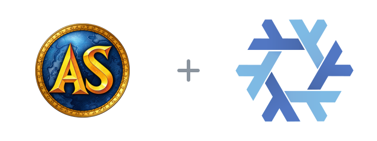

<p align="center"></p>
<p align="center"><a href="https://wow.aethus.pl/"></a> </p>
<h1 align="center">Azeroth Survivors for Nix</h1>
<p align="center">The official Windows game, ready to launch on Linux through Proton.</p>

Packages Aethus's game with a desktop launcher, a Proton runtime and the Vulkan setting used on our Linux machines. First launch creates a writable installation so the game's updater can work. Existing installations in `~/Games/azeroth-survivors` keep their updates, prefix and saves.

## Play

```sh
nix run git+ssh://git@neo.netbird.cloud:2222/fractal-tess/azeroth-survivors-flake.git
```

Supports **x86_64 Linux**. The pinned Windows archive is about 755 MB; its extracted data and Proton need several GB. A fresh installation starts at v0.102.3; use the game's **Download & restart** prompt for newer releases. This packages the original binary, not the separate source reconstruction.

## NixOS or Home Manager

```nix
inputs.azeroth-survivors = {
  url = "git+ssh://git@neo.netbird.cloud:2222/fractal-tess/azeroth-survivors-flake.git";
  inputs.nixpkgs.follows = "nixpkgs";
};
```

Import `inputs.azeroth-survivors.nixosModules.default` into NixOS, or `inputs.azeroth-survivors.homeManagerModules.default` into Home Manager. Then enable:

```nix
programs.azeroth-survivors.enable = true;
```

The application menu entry is **Azeroth Survivors (Proton)**. Fresh installations live under `${XDG_DATA_HOME:-~/.local/share}/azeroth-survivors`; existing manual installations keep their current paths. The launcher prefers Steam's installed Proton Experimental or Hotfix, with a bundled GE-Proton fallback. It creates a separate Proton prefix; Steam itself does not need to be running.

## Packaging notes

`nix build` builds the launcher and game payload. `nix flake check` also checks the modules and launcher behavior. The archive is fetched directly from the developer and verified with a fixed hash. If the developer replaces that URL's contents, update the hash and base version in `packages/azeroth-survivors.nix`; Nix will reject mismatched downloads.

The game, game data and Proton prefix are never committed to this repository. Packaging code is [MIT licensed](LICENSE); the game and Warcraft artwork retain their owners' rights. [Aethus's original game](https://wow.aethus.pl/) is not affiliated with Blizzard. The [Nix snowflake](https://github.com/NixOS/nixos-artwork) is NixOS artwork, used without modification under its upstream license.
